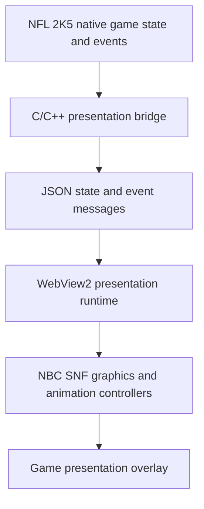

# How the NBC Sunday Night Football scorebug was built

**NFL2K5-PC · Development writeup · October 16, 2026**

The SNF work is a selectable broadcast presentation package for the native NFL 2K5 PC project. It takes football information from the game and draws a separate, editable television graphics layer: the scorebug, player statistics, pregame cards, lineup introductions, scoring sequences, replay transitions and break score displays.

The target is the **2022 NBC SNF system**, including its circular clock pod and dark team-colored glass. Later NBC graphics were reviewed as distinct variants rather than silently mixed into this design. Reference screenshots, designer animation examples, supplied logos and supplied fonts guided the implementation.

The package lives in `mods/presentations/NBC_SNF/`. Its appearance and motion are implemented in HTML, CSS, JavaScript and SVG, hosted by the project's WebView2 presentation layer. The game's native C/C++ bridge supplies the data. The current work builds on the project's existing presentation host and renderer.

## 1. Building the scorebug from the reference

The first step was to break the reference into independently controlled elements:

- Away and home team panels, logo windows, abbreviations and records.
- Separate score numerals and three timeout indicators per team.
- Central circular pod, peacock, game clock, quarter numeral and ordinal.
- Possession-side down-and-distance tab and play clock.
- Penalty treatment within the pod.

The compact scorebug uses a **576-pixel design width** inside the package's **1920 × 1080 broadcast canvas**. Positions are measured in that design space and scaled together. This keeps the relationships between the logos, scores, clock and team panels consistent as the output resolution changes.

Existing reference-derived artwork supplies details such as the pod rim, glass, rail and selected logo-window crops. CSS and SVG supply the editable layers, team-color treatments, masks, highlights and motion. Scores, clock values, team identities and statistics remain separate live fields; changing a matchup does not require painting new score numerals into an image.

The known Rams/Bengals reference crops retain their measured placements. Other teams use the package's complete logo assets or the logo supplied by the game. Failed crop loads fall back to the complete logo without repeatedly requesting the same missing asset on every state update.

For ultrawide output, the normal graphics retain their broadcast proportions in a centered design region. Full-screen replay covers extend into the additional viewport width rather than stretching the scorebug itself.

## 2. Matching the lettering

A font name alone was not enough to match the reference. The layout code measures actual letter and numeral bounds, then places text according to its observed cap height, width and anchor.

The supplied Ringside fonts are assigned by role:

| Role | Current approach |
| --- | --- |
| Scores, clock and quarter numeral | Ringside Condensed Ultra, fitted to the reference's measured bounds |
| Team records | Ringside Narrow Medium |
| Team abbreviations | SVG outlines derived from the supplied Wide Black Italic face, with the slant removed and placement fitted independently |
| Small labels and attached player text | Separately selected faces and weights appropriate to each reference element |

The clock uses individual glyph placement and a raised colon. Stretching the entire `15:00` string as one block had made the `1` too wide and displaced the following digits. Per-character advances preserve the intended shape while the time changes.

The outline renderer keeps accessible text labels and falls back to real text when a character is unsupported. Repeated updates replace the prior content so clocks and abbreviations cannot accumulate duplicate glyphs.

Visual review also exposed a particular problem in the supplied TD fonts: their space character advances **25 em**. A multiword quarter footer therefore wrapped outside its visible strip, leaving only `END` visible. The new summary footer uses the package's existing space-only face before the original letter face, preserving the letters while providing normal spacing. A new capture verified the complete `END OF 1ST QUARTER` label.

These are measured matches using the available material. The precise original upright Wide/ExtraWide broadcast variant and all original NBC 3D assets have not been established as available, so exact identity is not claimed.

## 3. Connecting it to the game

The data flow is:



The shared runtime exposes `NFL2K5.onState()` for changing values and `NFL2K5.onEvent()` for football events. State supplies fields such as teams, scores, clock, quarter, possession, down-and-distance and presentation context. Events request sequences such as a touchdown, player card, replay or timeout.

For example, a state update can change Dallas's score, the current clock and the remaining timeouts. The SNF page updates those fields in its existing layout. A separate `TOUCHDOWN` event chooses the scoring animation. This distinction keeps the graphic's visual behavior independent of the game's football decisions.

Player inserts accept the identity, position, portrait and statistics supplied with their event. QB, rushing, receiving, defensive and kicking data have appropriate field layouts; a supplied native table can retain its own labels and values. Missing numbers remain unavailable, and an explicit zero remains zero. The package does not substitute a cached quarterback's identity for an unrelated player.

The scorebug also validates its basic data: invalid scores, game clocks, play clocks and timeout counts are hidden rather than rendered as `NaN`, `Infinity` or misleading available timeout marks.

## 4. Native player cards and coin toss

The native integration forwards the game's actual popup identity, caption, text, table cells and lifetime to the SNF page. Career facts and last-season tables remain distinct from ordinary current-game stat inserts.

Replacing native artwork requires an ownership handshake. The page acknowledges a specific replacement token after two animation frames. Native draw hooks can suppress the matching outgoing artwork only after that acknowledgment. The original popup's updates, selection callbacks and lifetime continue to belong to the game.

That matters especially for the coin toss: the SNF banner displays the game's actual choice rows, selected direction and configured button prompt. The game still receives the controller input and decides the outcome. Stale acknowledgments cannot acquire a newer popup, and the replacement releases its matching token when it closes.

The pregame matchup graphic also has a constrained trigger. It waits through crowd shots and may appear during a proven warmup/panning stage. It selects one actual highest-rated supplied player per team across positions. Unknown ratings do not default to a quarterback. Coin toss, kickoff, menus or an incompatible camera state cancel the pending opening.

## 5. Constructing the animations

Animations are assembled from controllable layers rather than a large prerecorded video. CSS transitions and keyframes animate the plates, logo contours, letter groups, portrait, chrome edge, light effects and masks. JavaScript coordinates their phases and ownership.

The attached THIS DRIVE graphic has its own foldout: team scores stack at the left, the pod moves beside them, and the player/stat rail expands. Independent compact player cards, large features, comparisons and team tables use separate compositions because the reference treats them as different graphics.

The scoring sequence follows the measured designer example's approximately **9.13 seconds of motion**, excluding its demonstration lead-in. It moves through segmented team panels, shaded logo, blue light, bright chrome, contraction into the pod, a scoring-drive carrier, score roll and return. Each queued scoring event captures its own score and drive data, so a later extra point cannot overwrite the touchdown's captured total.

Menus, invalid match state and replacement graphics cancel pending timers. An expired player card or old scoring callback cannot reappear after the user returns to gameplay.

## 6. Replay wipes and break graphics

`broadcast-transitions.js` provides one owner for replay-in and replay-out. Its phases are:

```text
HIDDEN → COVERING → COVERED → REVEALING → HIDDEN
```

Replay-out reverses the sweeping planes while keeping the wordmark readable. Duplicate notifications do not keep restarting the same wipe. Competing player cards, scorebug elements and other inserts clear before the transition paints, and conflicting insert events are suppressed during its ownership. Resumed play can interrupt the decoration immediately. Reduced-motion mode uses a short dissolve.

The latest period-graphics fix addressed a real event-ordering problem. The native bridge sends these together:

```text
QUARTER_ENDED → HALFTIME or OVERTIME, when applicable → QUARTER_STARTED
```

The old notice was immediately hidden by the last event. The package now groups that batch into an owned two-row score display. HALFTIME or OVERTIME takes precedence over the generic end-quarter label; FINAL requires the explicit game-ended event. The new quarter's reset clock is omitted from the ended-period graphic.

Live scores continue to update during the summary. After its hold, the rows exit while the summary retains ownership for **700 ms**, preventing the regular scorebug from appearing underneath departing rows. A snap, menu, invalid match or replay transition cancels it cleanly.

The two-row score display follows the previously inspected halftime geometry. The regular-season adaptation and replay curve/light sweep remain reconstructions; an exact 2022 replay-wipe source has not been verified.

## 7. Testing without launching the game

There are two complementary checks:

1. **Static lifecycle checks:** a Node harness loads the actual package scripts and shared runtime with a small DOM and virtual clock. It verifies state changes, event ordering, zero/unknown values, ownership, cancellation and delayed callbacks. The latest recorded result is **139/139 passing**.
2. **Standalone visual rendering:** the existing WebView2 presentation renderer loads the actual package, advances its real animation objects to deterministic times and captures frames. This checks fonts, clipping, layering, entrance/exit phases and ultrawide coverage. The sampled frames are encoded into review videos.

The deterministic preview clock is enabled only for explicit preview URLs. It does not change timers in an ordinary game presentation page. Preview teams, scores, names and statistics are sample inputs; the latest sample has Dallas leading Tampa Bay **21–14**.

The current transition review is `outputs/snf-previews/transitions-20261016/SNF-transitions-review.mp4`. That folder also contains quarter, halftime, overtime and final stills, individual motion clips and the recorded static-check result.

## 8. What is verified and what comes next

Earlier documented October 11 native captures reached real player fact cards, interactive coin toss, kickoff and progressing gameplay with SNF replacements. Those recordings establish particular tested integration paths, not every subsequent change.

The October 16 transition and summary work was checked with static tests and the standalone renderer. **No game launch, build, game control or debugger attachment was performed while Claude was working on the running game.** Current review clips are package previews with sample data.

The next permitted in-game pass should check actual replay and period-event timing, the newer native table/warmup mapping, and replacement ownership throughout entry and exit. Additional reference comparison is still needed for an exact NBC replay wipe and the remaining typography/3D differences. The whole package should not be described as fully verified or broadcast-identical yet.

## File guide

| File or directory | Responsibility |
| --- | --- |
| `mods/presentations/NBC_SNF/mod.json` | Package identity, entry page, canvas and declared replacement capabilities |
| `scorebug.html`, `scorebug.css`, `scorebug.js` | Core scorebug, measured text layout, scoring, lineup and attached/independent player inserts |
| `broadcast-fonts.css`, `broadcast-glyphs.js`, `wide-glyph-data.js` | Supplied fonts and measured abbreviation outlines |
| `broadcast-transitions.js` | Replay transition phases, cancellation and ownership |
| `broadcast-scenes.js`, `broadcast-scenes.css` | Matchup opening, corner branding, profiles, timeout and period summaries |
| `pregame-inserts.js`, `pregame-inserts.css` | Native fact/table and coin-toss replacements and acknowledgment lifecycle |
| `extra-inserts.js`, `extra-inserts.css` | Two-player comparisons and team tables |
| `preview.html`, `preview-scenes.js`, `preview-clock.js` | Standalone gallery, sample events and deterministic frame capture |
| `tools/nbc-snf/verify-package.js` | Static package lifecycle checks |
| `tools/nbc-snf/render-review.ps1` | Frame sampling and motion-review exports using the existing renderer |
| `src/nfl2k5_presentation.cpp` and related host files | Native data/event extraction and presentation hosting |

Reference and evidence notes: [reference inventory](SNF-REFERENCE-INVENTORY-20261009.md), [native integration](SNF-NATIVE-INTEGRATION-20261011.md), and [latest motion pass](SNF-MOTION-20261016.md).
